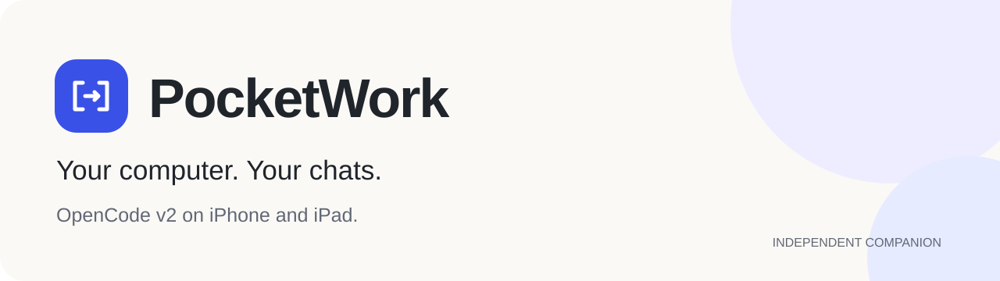

# PocketWork

PocketWork is an independent iPhone and iPad companion for [OpenCode](https://github.com/anomalyco/opencode), maintained by Salty Panda LLC. Pick up a chat, answer a question or review a file while the work keeps running on your computer.

**OpenCode-backed PocketWork1.0.0(9) is available to the existing internal TestFlight group.** Earlier0.1.0 builds use OpenWork. Physical-device acceptance and public App Store distribution remain pending. See [compatibility and evidence](docs/opencode-compatibility.md).

## In the native beta

- Built-in OpenCode v2 pairing by QR code or pasted link, saved in Keychain.
- Projects, recent chats, paged history, new chats, rename, fork and reviewed deletion.
- Models, supported variants, agents, ordered chat rules and pending approvals.
- Agent questions and forms, with answer drafts and explicit submission.
- Photos and supported files, registered skills, result previews and explicit sharing.
- Read-only working-copy changes and diffs.
- Local chat groups, project visibility choices and new-chat defaults.
- Expandable Activity, accessible input sheets and a bounded reader for long replies.
- Offline help/legal information and separate local draft, download, sharing and reset controls.

These are implemented features with synthetic and scoped native-host checks. They are not a claim that the complete release-candidate journey has passed on physical devices. Native host skill editing and scheduled work stay on the computer. Search covers chat titles, not message contents.

## Connect

The inspected baseline is **OpenCode 2.0.29**. Keep the compatible OpenCode server running and the computer awake.

1. In OpenCode Settings, enable its built-in **Remote access** and choose **Pair device**.
2. In PocketWork, scan the QR code or paste the pairing link.
3. Review the HTTPS address and connect. A pairing code expires after five minutes and can be used once.
4. Choose the projects and chats to display. Before sending or preparing attachments, review the reported AI-sharing context.

On a CLI-only host, OpenCode v2.0.29 also provides `opencode pair --remote`. It prints native pairing links and a QR code; scan the QR or copy its HTTPS link into PocketWork. If native Remote access is off, OpenCode asks before enabling it. The app ignores the QR's plain-HTTP local addresses and uses an advertised HTTPS address.

This connection uses OpenCode's native remote access. It needs no PocketWork bridge, OpenWork fork or separate Tailscale app. Normal TLS validation stays enabled. OpenCode may route encrypted traffic through OpenTunnel; the host and model-provider configuration still determine where work and data go.

**Pairing grants server-wide access.** Visible projects and “Show future projects” change this device's lists; they don't restrict the credential. Tool approval requests, saved grants and chat rules are separate controls. Forget removes the credential from this device and does not revoke it on the server. Read [Security](SECURITY.md) before pairing a shared server.

## Existing beta users

The app keeps the PocketWork name, existing Apple app record and bundle identity. OpenWork pairing cannot be reused with OpenCode. Earlier recoverable draft text stays separate for deliberate copying into a reviewed native chat; files, skills and uncertain actions are not silently moved or resent.

Build9 fixes free-model rejection in newly created chats and a premature “Delivery is uncertain” warning during ordinary sends. After updating, create a new chat in PocketWork to test the identifier repair; existing chats and IDs are preserved. TestFlight remains the beta update route, without a cable requirement. There is no public TestFlight invitation or App Store release for this candidate. See [migration and recovery](docs/migrating-from-openwork.md).

## Build and test

Use a Mac with Xcode and Swift 6. The universal target supports iOS/iPadOS 18 or later; core/state tests use macOS 15 or later. Available Simulator evidence currently covers iOS 26.5 and iOS/iPadOS 27. A deployment-target setting does not establish minimum-version runtime acceptance.

```sh
git clone https://github.com/BitL8-ByteShort/openwork-remote-ios.git
cd openwork-remote-ios
swift test
python3 scripts/generate-ios-project.py
open OpenWorkRemote.xcodeproj
```

Select the **OpenWorkRemote** scheme. Local Simulator Keychain tests may need ad-hoc signing. Device/App Store signing requires your own Apple configuration; no signing team, keys or provisioning files are included. For a compilation-only unsigned Simulator build:

```sh
xcodebuild -project OpenWorkRemote.xcodeproj \
  -scheme OpenWorkRemote -configuration Debug \
  -destination 'generic/platform=iOS Simulator' \
  -derivedDataPath build/DerivedData CODE_SIGNING_ALLOWED=NO build
```

There are no external Swift package dependencies. See [Contributing](CONTRIBUTING.md), [testing](docs/testing.md), [accessibility evidence](docs/accessibility-qualification.md) and [rendering limits](docs/rendering-and-responsiveness.md).

## Support and licensing

Email **support@saltypanda.com** or use [GitHub Issues](https://github.com/BitL8-ByteShort/openwork-remote-ios/issues). Issues are public. Leave out credentials, pairing links, transcripts and private host information.

The source and original artwork are [MIT licensed](LICENSE). The credited OpenCode logo has its own retained MIT notice in [NOTICE.md](NOTICE.md). PocketWork is independently maintained and isn't an official OpenCode product. OpenCode's maintainers aren't responsible for this app.

Read [privacy](https://bitl8-byteshort.github.io/openwork-remote-ios/privacy/), [support](https://bitl8-byteshort.github.io/openwork-remote-ios/support/) and [terms](https://bitl8-byteshort.github.io/openwork-remote-ios/terms/) at the stable information-site URLs. The exact approved offline copy is in [bundled information](OpenWorkRemote/Resources/Information/); its manifest records policy version2026-10-15.1.
